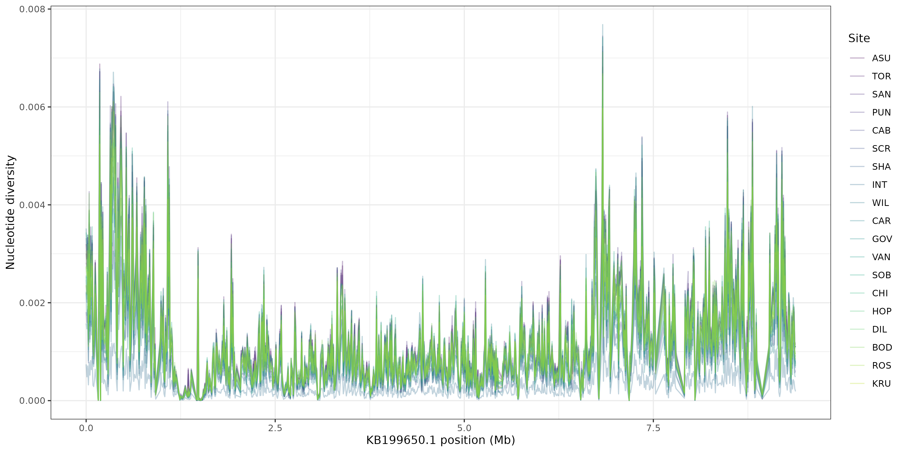
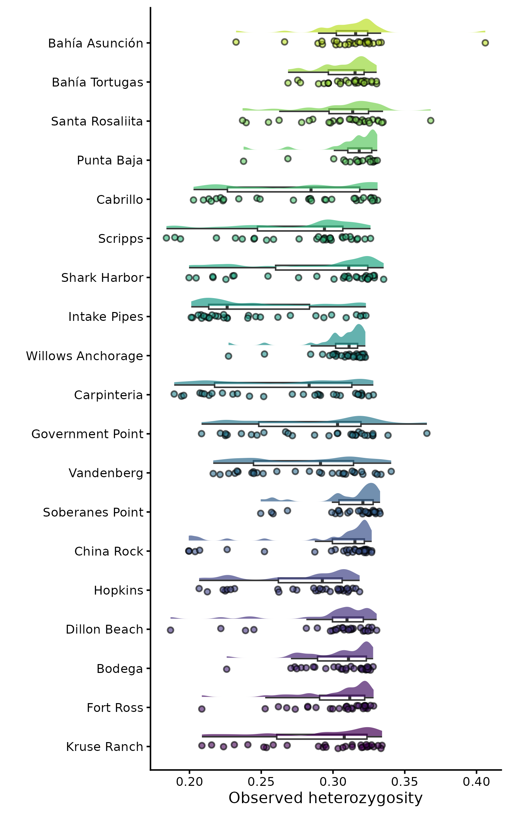
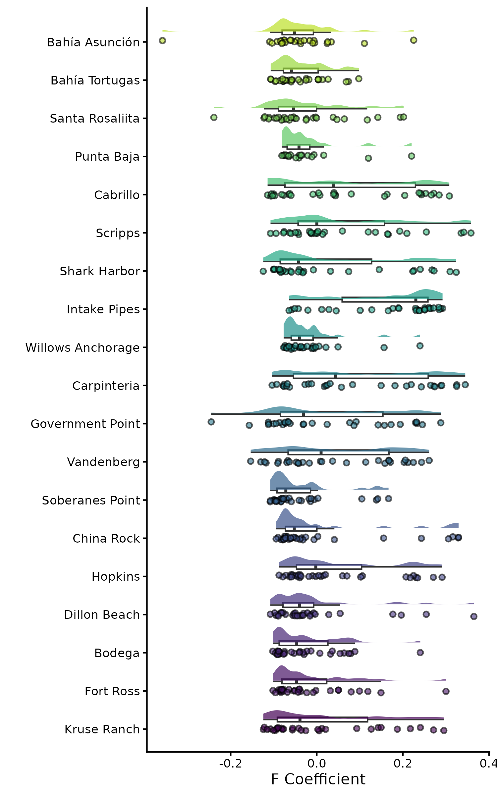
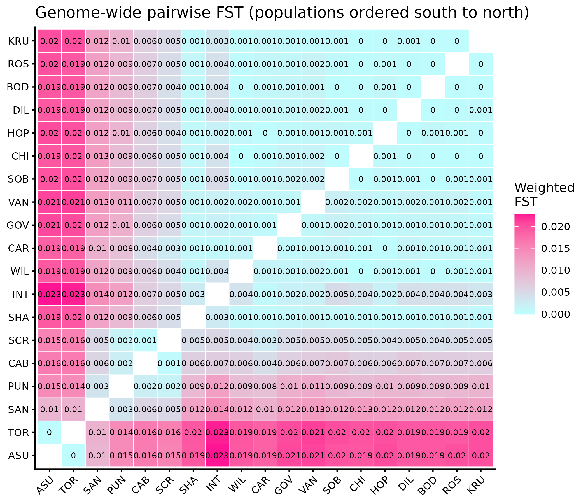
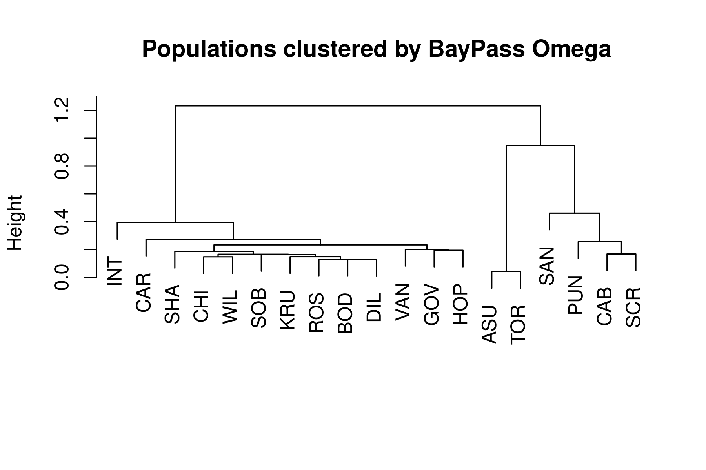
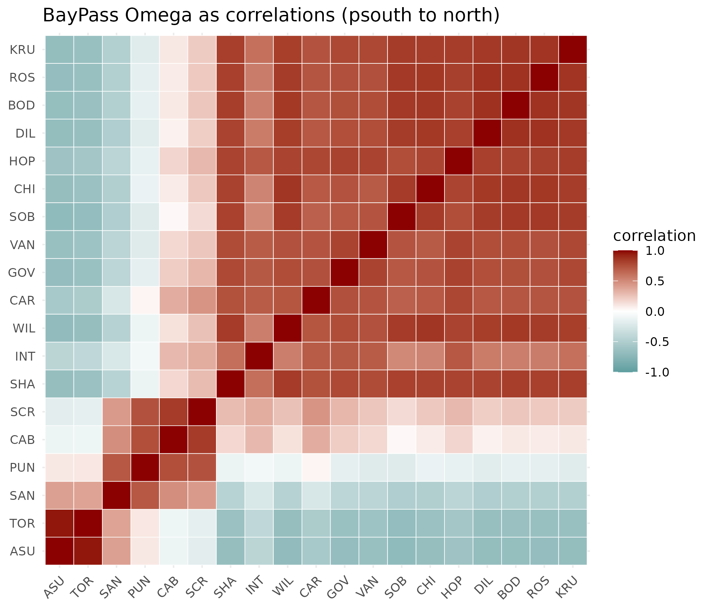
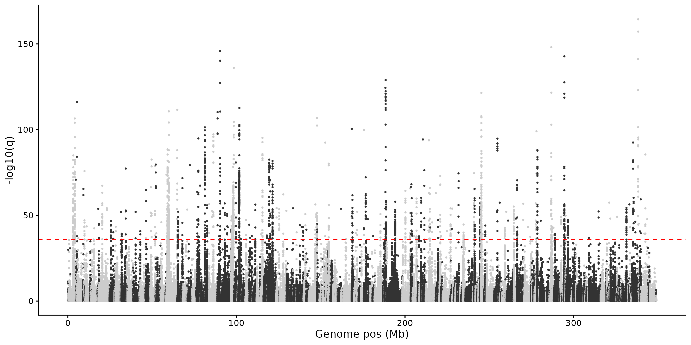
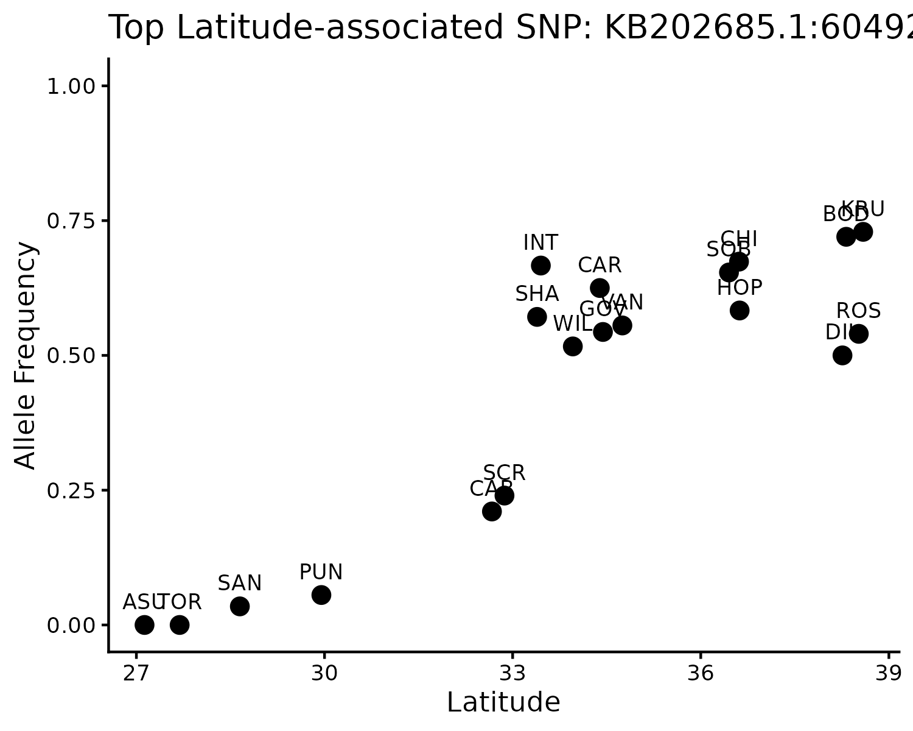

```{r setup, include=FALSE}
knitr::opts_chunk$set(echo = T
```

## 10.13.2026 - Starting Population Genomics!!!

#### Notes to start:

-   A VCF (Variant Call Format) file stores the positions in the genome where variants were found among our samples, along with every individual’s genotype at those positions. It has two parts:

-   a header: lines starting with \## that record how the file was made and define every field used in it

-   a body: one line per variant

#### BASH

-   got the VCF files needed to start pop gen

## 10.15.2026 -

### Fixing Git

Changed .gitignore to contain pop genomics and pushing works now!

## 10.15.2026 - PopGen PCAs and Admixture

Pruned #s:

-   549850 Lg_LD_0.2.prune.in

-   1271900 Lg_LD_0.2.prune.out

-   1821750 total

### All plots are done with SUBSETTED data


### Admixture


-   3 would be the best to use because it has the lowest error


-   you would choose K2 or K3

-   The K# is the same as the number of colors in the coloumns, so in K5 you can see its kindave forcing the pink to show

-   In the far right, you can see that the 2 bahia populations are constantly different

## 10.22.2026 - Genetic Diversity

Can be:

-   within an individual

-   within a population

-   within a species

### Metrics:

-   Heterozygosity

-   Private alleles (allele richness)

-   Fst (variation between subpopulations vs total variation across all samples)

-   Affective population size (Ne, AKA what individuals are contributing to the next generation, genetically)

-   Nucleotide Diveristy (pi)

-   Inbreeding Coefficant (Fis)

Allele Frequency -\> p + q = 1

HWE = p2 + 2pq + q2 = 1

#### (Inbreeding Coefficent) Fis = 1 - (Ho/He)

-   Fis = 0

-   Fis = negative = excess

-   Fis = positive = inbred

Tajimas D (Nucelotide Diversity)

= 0 = Normal

\>0 = excess of common mutations, balancing selection,

\<0 = excess of rare mutations, selective sweep, or when a population has rapid population expansion

### Coding:

-   copied

VCFtools version: 0.1.16

\`

```         
> pi_summary
# A tibble: 19 × 5
   Population Latitude n_windows  mean_pi median_pi
   <chr>         <dbl>     <int>    <dbl>     <dbl>
 1 ASU            27.1     33942 0.00139   0.00111 
 2 BOD            38.3     33976 0.00140   0.00113 
 3 CAB            32.7     33959 0.000810  0.000651
 4 CAR            34.4     33947 0.000723  0.000582
 5 CHI            36.6     33977 0.00120   0.000971
 6 DIL            38.3     33977 0.00126   0.00101 
 7 GOV            34.4     33970 0.00108   0.000876
 8 HOP            36.6     33970 0.00114   0.000918
 9 INT            33.4     33834 0.000310  0.000247
10 KRU            38.6     33979 0.00114   0.000917
11 PUN            30.0     33944 0.00146   0.00117 
12 ROS            38.5     33983 0.00131   0.00105 
13 SAN            28.6     33966 0.00137   0.00110 
14 SCR            32.9     33971 0.00104   0.000840
15 SHA            33.4     33971 0.00104   0.000836
16 SOB            36.4     33985 0.00145   0.00117 
17 TOR            27.7     33941 0.00142   0.00113 
18 VAN            34.8     33958 0.000926  0.000745
19 WIL            34.0     33985 0.00146   0.00118 
```


## 10.27.2026 - Continuing with Pi Analyses and others

-   Interested in sites w high diversity because if everything was netural aeveyrhting would fix or dissappear, sites w high diversity means something is keeping it at a high diversity (aka from dissappearing or fixing), so if you find a region w high doversity its because something in the genome is relative to the environment or because historically something deemed that important.





## Tajimas D

-   negative = excess of rare alleles
-   positive = excess of common alleles
-   negative/stabilizing selection = more positive distribution
-   positive selection = more negative distribution


### Heterozygosity

-   heterozygosoty and pi are both used to calculate diveristy but in different ways

-   need relatively high coverage to use



-   tightly clustered towards the right is higher, seems like slightly less in the southern sites.



-   appears to be mostly centered around zero




-   definitely a corralation between fst and latitude (positive)

## 10.29.2026 - Baypass






-   P value is corrected by the number of populations

-   Usually w baypass u dont use p-values




-   thetao_mean is average sea surface temperature


-   would expect or hope for a negative or positive correlation not just a straight line



-   more what was expected
